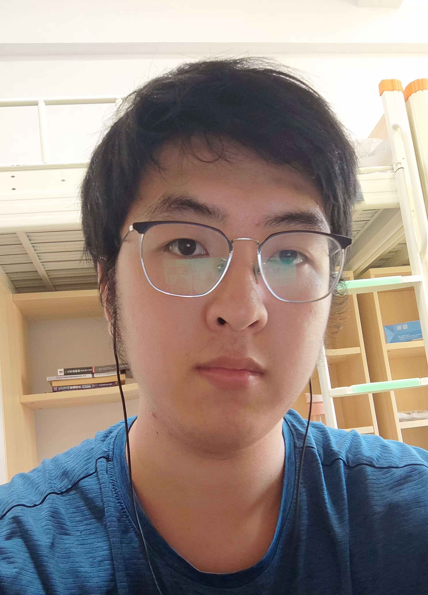
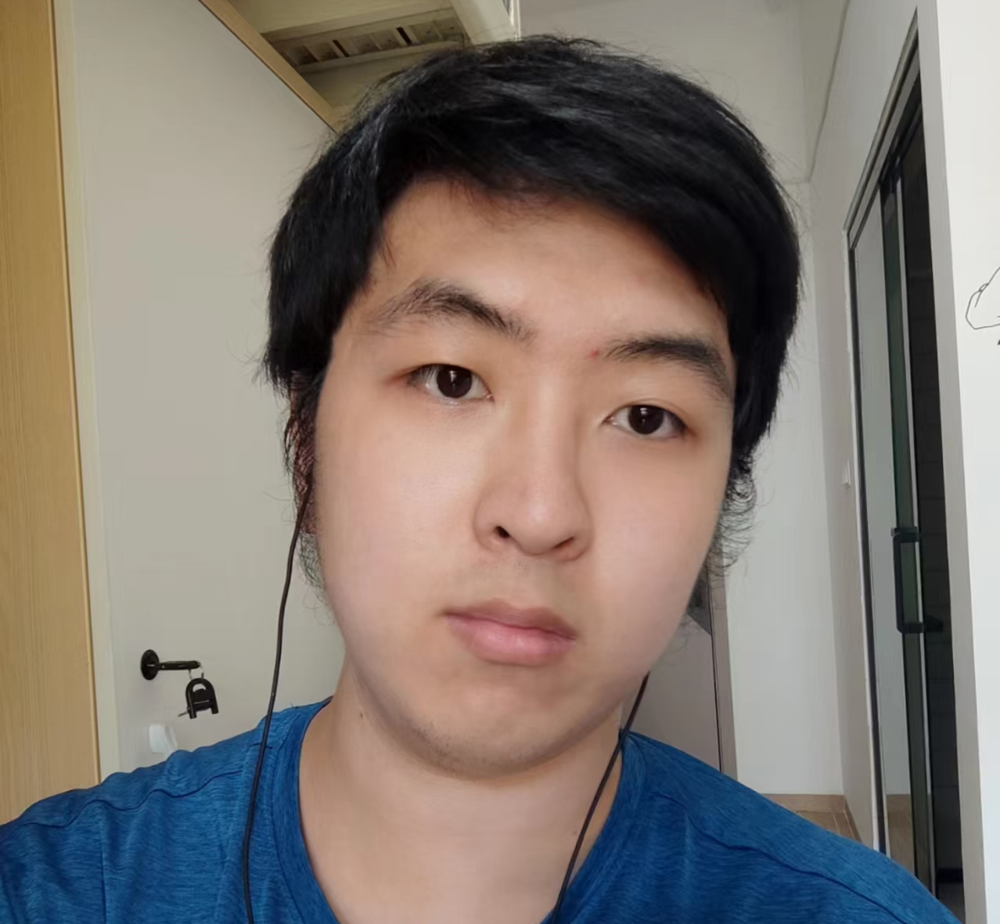

# About Me

<!--  -->

Here is **Yibo Ma (马義波)**. 

I am a second-year Ph.D. student in the [**UKRI Centre for Doctoral Training in Machine Learning Systems (MLSys CDT)**](https://mlsystems.uk) at the University of Edinburgh, supervised by [**Prof. Mahesh K. Marina**](https://homepages.inf.ed.ac.uk/mmarina/) and [**Prof. Amos Storkey**](https://homepages.inf.ed.ac.uk/amos/). I am also a member of the [**Networked Systems (NetSys) Group**](https://netsys.inf.ed.ac.uk/). My research lies at the intersection of **Networking and ML Systems**, with a focus on building intelligent, efficient, and robust networked systems.

I obtained my M.S. degree from Tsinghua University under the supervision of [**Prof. Yong Li**](https://fi.ee.tsinghua.edu.cn/~liyong/), where my thesis was awarded the Outstanding Thesis Award. I earned my B.S. degree from Tongji University.
<!-- I earned my B.S. degree from Tongji University, advised by [**Prof. Yaobao Yin**](https://mefaculty.tongji.edu.cn/info/1296/3241.htm). -->

I am always open to discussions and collaborations. Feel free to reach out to me at <u>mayibo2hyh [at] gmail.com</u>.

Here is my Resume: [Resume](./file/resume_Yibo_Ma.pdf)

---

## Research Interests

- Network Digital Twinning
- Optimization of Energy Efficiency in Mobile Networks
- Data-driven and AI-based Approaches for Networking

My research envolves **measurement, simulation, and optimization of networked systems**. I analyze real-time operational data, simulate system dynamics, and develop optimization algorithms to reduce energy consumption and carbon emissions. I specialize in **Network Digital Twin technology** to enhance the performance and sustainability of **large-scale networked systems**, such as mobile networks and geo-distributed data centers.

---

## News and Updates

- **Aug 2026：**🎉 Our paper CausalTune has been accepted by ACM SIGCOMM ’26! Bolun will present the work at the conference.
- **Aug 2026：**🎉 I have successfully completed my first-year review. Many thanks to Prof. Mahesh K. Marina, Prof. Amos Storkey, and Prof. Rik Sarkar for their valuable feedback and suggestions..
- **May 2026：**🎉 I completed my volunteering at ICC ’26. It was a great experience meeting many excellent researchers and learning from the insightful and cutting-edge research presentations.
- **May 2025：**🎉 I successfully defended my Master’s thesis and was awarded the Outstanding Master’s Thesis by Tsinghua University (top 1 among 30+ students).
- **Dec 2024：**🎤 I presented my work *Sustainable Connections: Exploring Energy Efficiency in 5G Networks* at ACM CoNEXT 2024, receiving great discussions and valuable feedback—thanks for the interest!
- **Nov 2024：**🎉 I received the First-Class Chaozhou Talent Scholarship from Tsinghua University in recognition of my research work. I sincerely thank the sponsors and the university for this support and encouragement!
- **Aug 2024：**🎉 The 2nd Research Summit of Urban Science and Human Dynamics was successfully held at Tsinghua University!
- **July 2024：**I completed the defense of the practice report in Guiyang.
- **July 2024：**🎉 Our paper was accepted by *ACM CoNEXT 2024*. See you in Los Angeles!
- **Jun 2024：**🎉 Our paper was accepted by *IEEE TNSM*.

 
